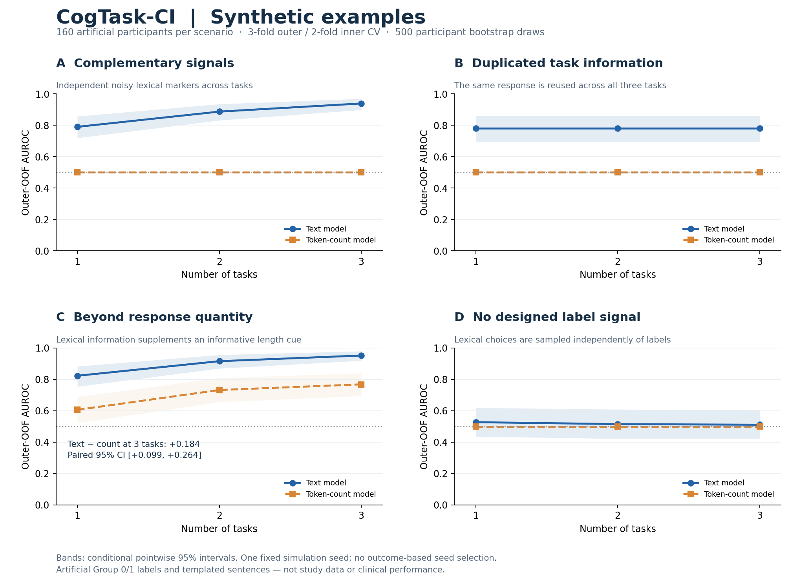

# CogTask-CI

**Multi-task Text Evaluation for Cognitive Impairment Research**

Evaluate the predictive value and complementarity of multiple text tasks with participant-level nested cross-validation. Bring your own authorized, pre-cleaned text and binary research labels. No pretrained diagnostic model, clinical label mapping, corpus download or server is included.

**MIT-licensed · Python 3.10+** · [Source repository](https://github.com/jkjkiiiii/cogtask-ci). No PyPI release is advertised. [Licence](LICENSE), [quickstart](docs/quickstart.md), [data/configuration reference](docs/reference.md), [nested evaluation and replay reference](docs/reference_evaluation.md), [related publication](docs/related_publication.md).

CogTask-CI is a research toolkit for evaluating task combinations on your own authorized text data. See [related publication](docs/related_publication.md) for the associated article title.

## See what the toolkit does



**Entirely synthetic data, not clinical performance.** Each panel is an actual nested evaluation of readable, templated English sentences with artificial Group 0/1 labels. Curves show text and token-count models; bands are conditional pointwise 95% participant-bootstrap intervals. One fixed seed/configuration was used without searching for favorable results.

| Example | What to look for |
|---|---|
| **A · Complementary** | Independent artificial lexical signals can add useful information across tasks. |
| **B · Redundant** | Reusing the same response across tasks adds no new information. |
| **C · Beyond quantity** | Independent lexical information can add discrimination beyond an informative token-count baseline. |
| **D · Null** | Without a designed signal, finite-sample estimates can fluctuate around chance. |

[Explore the examples](docs/examples.md) · [SVG figure](docs/assets/showcase.svg) · [Synthetic aggregate values](docs/assets/showcase_summary.csv) · [Paired comparisons](docs/assets/showcase_contrasts.csv) · [Fixed configuration](docs/assets/showcase_config.json)

Rebuild the overview after installing this source version:

```console
python -m cogtask_ci showcase --output results/showcase --assets docs/assets --replace-assets
```

The interactive [four-scenario walkthrough](examples/03_synthetic_showcase.ipynb) uses smaller settings for speed. The [CSV workflow](examples/04_csv_workflow.ipynb) demonstrates importing your own format and handling a missing task, using synthetic input only.

## Install and try

Python 3.10+ is required. In a fresh virtual environment, from this directory:

```console
python -m pip install .
cogtask-ci demo --output results/quickstart
```

Open `results/quickstart/run/report.html`. The demo generates artificial lexical signals, equal-length tasks and a deliberately redundant task. It is an illustration of the evaluation workflow, not evidence of cognitive impairment detection. A successful small demo does not guarantee a particular task-budget ordering.

If the console entry point is not on your PATH, use `python -m cogtask_ci` instead of `cogtask-ci`.

For notebooks: `python -m pip install ".[notebook]"`, then open `examples/01_quickstart.ipynb` or `examples/02_task_complementarity.ipynb` with Jupyter. Public documentation and examples are in English; no Chinese-language material is required to use the tool.

## Your data

JSONL, one subject/task record per line:

```json
{"subject_id":"S001","task":"description","label":1,"segments":[["a","person","walking"],["near","a","house"]]}
```

Use strings for subject IDs and task names and integer labels 0/1. Tokens cannot contain whitespace. Each segment must contain tokens; do not use an empty segment for a missing task. Omit missing task records. All tasks for one participant share one label; duplicate subject/task records are rejected. Identifiers must be unique across the entire input dataset. Prepare speaker selection, consent and transcript cleaning before import. Do not combine datasets with incompatible endpoints. The tool does not interpret 1 as a particular clinical diagnosis.

For a UTF-8 CSV with `subject_id,task,label,text`:

```console
cogtask-ci import-csv local_data/text.csv --output local_data/text.jsonl
cogtask-ci validate local_data/text.jsonl
cogtask-ci evaluate local_data/text.jsonl --config examples/default_config.json --output results/my_run
cogtask-ci report results/my_run
```

CSV import splits text on Unicode whitespace, retaining case and punctuation. It is not a CHAT parser or a language-specific tokenizer; use segmented JSONL when linguistic tokenization or transcription gaps matter. Word n-grams never cross segment boundaries. `--lowercase` is explicit on import; evaluation has the equivalent config option. Preserve the choice in your research protocol. For scripts without whitespace word boundaries, supply your own tokens.

## What gets evaluated

- One per-task model: word unigram/bigram and word-boundary character 3–5-gram TF-IDF (separate 20,000-feature limits, `min_df=2`, sublinear TF), concatenated into balanced logistic regression (`C=1`). A one-character token remains eligible. All vocabularies and IDF values are fitted within training partitions.
- All tasks share participant-level outer/inner folds. Default: 5 outer folds, 3 inner folds, 1 repeat, seed 42. For each budget k, exhaustive combinations are ranked using pooled inner-OOF AUROC; the best combination is refitted on outer training data and evaluated on outer test participants. Ties follow sorted task names. k=1 is independently inner-selected, not the best outer-test single task. Fusion is the unweighted mean of task probabilities; it is not a learned or individualized acquisition policy.
- All k values share the complete-task evaluation set. Incomplete participants can contribute available training tasks. Complete participants are stratified for both splitting levels; extra participants are distributed within class. Each required evaluation fold and each task training partition needs both classes. At most 10 tasks are accepted (up to 1,023 candidate combinations); computational cost rises rapidly with task count.
- A quantity-only baseline uses log(1 + token count), training-only standardization and balanced logistic regression with the same selection procedure.
- Optional `token_budget`: retain complete participants with at least that many tokens in every task. On this same population, rerun full text, quantity and first-N-token text arms, using original outer fold identities. Tokens retain the configured case transformation and segment boundaries. Training for these matched arms is restricted to the same eligible participants. N is **per task**: a k-task combination uses k*N tokens. This is a per-task prefix sensitivity analysis; it does not hold total token count constant across different task counts. No alternative random crops are searched. All arms are preflight-checked before fitting.
- AUROC is calculated from all outer-OOF participant predictions within each repeat and averaged across repeats. 95% intervals use class-stratified participant bootstrap, sharing resamples across repeats and paired comparisons. Folds are not treated as independent samples. Intervals condition on fitted models and realized folds; they do not include model-development uncertainty. Selection frequency is a stability description, not causal importance.

Optional fixed splits: `--splits splits.csv`, with zero-based `repeat,subject_id,outer_fold`. Every input participant must appear exactly once in every repeat, with folds inside the configured range. Inner folds are generated deterministically from outer-training participants. Reuse exported outer splits to repeat the procedure.

## Python API

```python
from cogtask_ci import Config, validate_dataset, evaluate, render_report

coverage = validate_dataset("local_data/text.jsonl")
metrics = evaluate("local_data/text.jsonl", "results/api_run",
                   Config(outer_folds=5, inner_folds=3, token_budget=50))
report_path = render_report("results/api_run")
```

New evaluation directories are required. A failed run keeps a `status.json` and log for diagnosis; choose a new directory after fixing the problem. The report command intentionally regenerates the report and figures in an existing completed run. Imports perform no analysis or data access.

## Output contracts

| Output | Contents |
|---|---|
| `summary.csv` | Per-arm/k AUROC, 95% interval and paired gain over inner-selected k=1 |
| `contrasts.csv` | Paired between-arm differences in absolute AUROC and in gains over each arm's own single-task policy |
| `predictions.csv` | Local-only outer-OOF scores, labels, participant IDs, repeat, fold, arm and k |
| `selections.csv`, `selection_frequency.csv` | Inner-selected combinations and their frequencies |
| `outer_splits.csv`, `inner_split_audit.csv` | Participant assignments and inner roles; incomplete held-out participants are distinguished |
| `coverage.json` | Input coverage, common evaluation set size, excluded IDs and matched population |
| `config.json`, `environment.json`, `provenance.json` | Configuration, environment, input/split SHA256 and installed package source hashes |
| `run.log`, `status.json` | Progress and terminal success/failure |
| `report.html`, `task_budget.{png,svg,pdf}` | Static local report and exportable figures |

Do not publish participant-derived outputs automatically. Reports include coverage exclusions; hashes may also permit linkage. The repository's examples and CI use synthetic data only. `local_data/` and `results/` are ignored by Git, but an ignore rule is not a substitute for reviewing a release.

## Reproducibility and provenance

The public repository contains software and synthetic examples. It contains no participant corpus, study results, manuscript comparison tables or real-data validation outputs. Each run records its configuration, environment, split assignments and input hashes for local reproducibility.

For development:

```console
python -m pip install -e ".[dev,notebook]"
python -m unittest discover -s tests -v
python -m build
```

Windows and Linux checks are defined in `.github/workflows/ci.yml`; they must run on the hosting service before claiming remote CI passes. Same inputs, configuration and software environment should reproduce split identities and predictions; exact floating-point agreement across hardware/library versions is not guaranteed. Match and record environments for comparisons.

## Licence and citation

Code, original documentation and synthetic examples use the [MIT License](LICENSE). The associated manuscript, figures, source corpora and participant-derived outputs are separate works and are not relicensed here. See [dependency notices](THIRD_PARTY_NOTICES.md).

Use [CITATION.cff](CITATION.cff) for the software citation; it currently credits the collective **CogTask-CI contributors**. No paper/software DOI has been assigned here. [Contributing](CONTRIBUTING.md).
