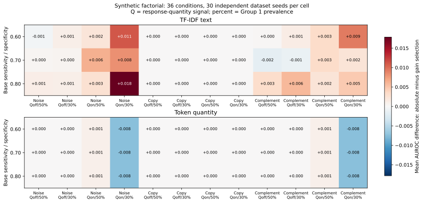

# Reproducing the synthetic factorial

The factorial isolates task signal, task redundancy, response quantity and label imbalance in artificial text. It is a software and evaluation-behavior example, not evidence of clinical performance.

The fixed design has 36 conditions and 30 independent dataset seeds per condition. Each dataset has 200 participants and three tasks, evaluated with three outer folds, three inner folds and one repeat. Task A has sensitivity and specificity 0.60, 0.70 or 0.80. The other tasks contain no label information, duplicate A exactly, or add conditionally independent markers with sensitivity and specificity 0.75. Group 1 prevalence is exactly 50% or 30%. Quantity signal is either absent or changes the probability of a long response from 0.35 in Group 0 to 0.65 in Group 1. Long responses have four times as many tokens as short responses.

Fit all conditions using the base installation:

```console
cogtask-ci factorial --output results/factorial
python -m cogtask_ci.factorial_summary results/factorial --output results/factorial_summary
python scripts/plot_factorial.py results/factorial_summary/condition_summary.csv --output results/factorial.svg
```

The fit stage saves separate text and quantity-model bundles. The summary stage evaluates every fixed pair with three references, absolute-performance and incremental-performance pair selection, and task-count tolerances 0, 0.01 and 0.02. It also evaluates 1,000 random policies: each policy chooses one pair per outer fold, shared by all participants in that test fold. Random predictions are never averaged into an ensemble.

The main summary CSV uses each generated dataset as one independent replicate. Means, sample standard deviations and quantiles are reported only for complete seed sets. Missing conditions, changed inputs, changed code provenance or incomplete artifacts are reported explicitly. A random-policy percentile describes a policy's position within its dataset's random-selection distribution; it is not a participant confidence interval. Task counts and training token burdens are descriptive measures, not clinical administration times.

The existing [four-scenario showcase](examples.md) additionally retains a completely uninformative label example. It is distinct from the factorial's no-information-added-task condition, where task A still carries signal.

The [evaluation reference](reference_evaluation.md) documents hash-based resume and optional protocol/code identifiers. For a quick check, fit a stable slice with `--start-index` and `--limit`; the full summary remains explicitly incomplete until every required condition and seed is present.

## Completed synthetic example

The supplied artifacts contain all 1,080 datasets and 2,160 text/quantity arm replays. Each condition has all 30 generation seeds. Exact-duplicate tasks produce zero difference between the two pair-selection policies in every condition; the quantity-only model is at AUROC 0.5 when the quantity signal is absent. These are checks of the artificial design and implementation.



[Aggregate metrics](assets/factorial_summary.csv) · [Task-selection frequencies](assets/factorial_task_selection.csv) · [Design and source versions](assets/factorial_config.json)

The cells show means across dataset seeds. They are not participant confidence intervals, clinical outcomes, or a guarantee that one selection policy wins in another dataset. The CSV retains all conditions and across-seed dispersion.
